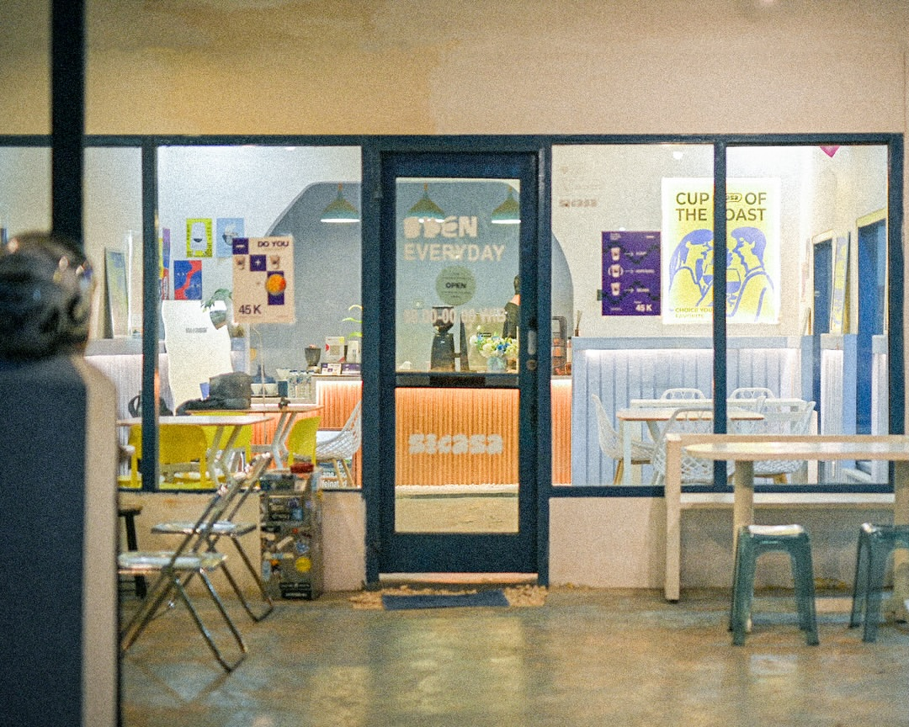

<p align="center"><a href="https://laravel.com" target="_blank"></a></p>
<p align="center">
<a href="https://github.com/laravel/framework/actions"></a>
<a href="https://packagist.org/packages/laravel/framework"></a>
<a href="https://packagist.org/packages/laravel/framework"></a>
<a href="https://packagist.org/packages/laravel/framework"></a>
</p>

## About Laravel

Laravel is a web application framework with expressive, elegant syntax. We believe development must be an enjoyable and creative experience to be truly fulfilling. Laravel takes the pain out of development by easing common tasks used in many web projects, such as:

- [Simple, fast routing engine](https://laravel.com/docs/routing).
- [Powerful dependency injection container](https://laravel.com/docs/container).
- Multiple back-ends for [session](https://laravel.com/docs/session) and [cache](https://laravel.com/docs/cache) storage.
- Expressive, intuitive [database ORM](https://laravel.com/docs/eloquent).
- Database agnostic [schema migrations](https://laravel.com/docs/migrations).
- [Robust background job processing](https://laravel.com/docs/queues).
- [Real-time event broadcasting](https://laravel.com/docs/broadcasting).

Laravel is accessible, powerful, and provides tools required for large, robust applications.

## Learning Laravel

Laravel has the most extensive and thorough [documentation](https://laravel.com/docs) and video tutorial library of all modern web application frameworks, making it a breeze to get started with the framework.

In addition, [Laracasts](https://laracasts.com) contains thousands of video tutorials on a range of topics including Laravel, modern PHP, unit testing, and JavaScript. Boost your skills by digging into our comprehensive video library.

You can also watch bite-sized lessons with real-world projects on [Laravel Learn](https://laravel.com/learn), where you will be guided through building a Laravel application from scratch while learning PHP fundamentals.

## Agentic Development

Laravel's predictable structure and conventions make it ideal for AI coding agents like Claude Code, Cursor, and GitHub Copilot. Install [Laravel Boost](https://laravel.com/docs/ai) to supercharge your AI workflow:

```bash
composer require laravel/boost --dev

php artisan boost:install
```

Boost provides your agent 15+ tools and skills that help agents build Laravel applications while following best practices.

## Contributing

Thank you for considering contributing to the Laravel framework! The contribution guide can be found in the [Laravel documentation](https://laravel.com/docs/contributions).

## Code of Conduct

In order to ensure that the Laravel community is welcoming to all, please review and abide by the [Code of Conduct](https://laravel.com/docs/contributions#code-of-conduct).

## Security Vulnerabilities

If you discover a security vulnerability within Laravel, please send an e-mail to Taylor Otwell via [taylor@laravel.com](mailto:taylor@laravel.com). All security vulnerabilities will be promptly addressed.

## License

The Laravel framework is open-sourced software licensed under the [MIT license](https://opensource.org/licenses/MIT).
# ☕ Sicasa Social Space — Smart Cafe POS & QR-Ordering System

<p align="center">
  
</p>

<p align="center">
  <strong>Sistem Manajemen Point of Sales (POS) & Pemesanan Mandiri Meja Berbasis Web & Progressive Web App (PWA) untuk Sicasa Social Space Padang.</strong>
</p>

<p align="center">
  
  
  
  
  
  
</p>

---

## 📌 Ringkasan Sistem (Project Overview)

**Sicasa Social Space POS & Self-Service QR Ordering** adalah aplikasi cerdas yang dirancang untuk mendigitalisasi dan mengefisiensikan seluruh alur operasional cafe. Sistem ini menghubungkan tiga pilar utama operasional:

1. **Pelanggan (Customer Self-Service):** Pesan langsung dari meja via scan kode QR tanpa perlu antre di kasir.
2. **Kasir (Cashier & POS):** Pantau antrean masuk secara *real-time*, verifikasi pembayaran tunai, kelola pesanan bungkus (*Take-away*), dan cetak struk termal.
3. **Pemilik (Owner Analytics):** Pantau omzet penjualan harian/mingguan/bulanan, produk terlaris (*Best Seller*), serta ekspor laporan keuangan terstruktur ke Microsoft Excel.

Aplikasi ini juga dibangun dengan standar **Progressive Web App (PWA)** sehingga dapat diinstal di smartphone/tablet dan tetap menyediakan halaman *offline fallback* ketika koneksi internet terputus.

---

## ✨ Fitur Unggulan Sistem

### 1. 📱 Portal Pelanggan (Self-Service QR Ordering)
* **Direct Table Entry (`/` & `/qr/meja`):** Pelanggan otomatis diarahkan ke menu pemesanan meja saat mengakses domain utama.
* **Katalog Resmi 10 Kategori & 58 Menu:** Terbagi rapi ke dalam *Signature Drink, Espresso Series, Manual Brew, Tea Series, Milk Series, Iced Blend, Sparkling, Makanan Utama, Snack,* dan *Lain-lain*.
* **Keranjang Belanja Interaktif:** Tambah/kurang item secara instan didukung Alpine.js tanpa reload halaman.
* **Dual Payment Gateway:**
  - **QRIS Dinamis (Midtrans Integration):** Polling otomatis status transaksi, simulator ramah pengujian (*Spacebar / Double-click trigger*), dan verifikasi *settlement* otomatis.
  - **Tunai di Kasir:** Menghasilkan kode pesanan unik dan QR Code untuk diverifikasi kasir.
* **Struk Digital & Unduh Gambar:** Menampilkan rincian nota digital pelanggan yang dapat langsung diunduh ke galeri HP (*format PNG/JPEG*).

### 2. 💻 Modul Kasir & Point of Sales (POS Shift)
* **Dashboard Shift Real-time:** 4 kartu metrik presisi (*Total Pendapatan, Kas Tunai di Laci, Antrean Verifikasi, Pesanan Selesai*) dengan penyesuaian zona waktu WIB (`Asia/Jakarta`).
* **Live Order Notification:** Notifikasi suara bel (*audio chime*) otomatis berbunyi di komputer kasir setiap kali ada pesanan baru masuk dari meja.
* **Mesin Kasir POS (Take-away):** Antarmuka cepat untuk melayani pesanan bungkus/bawa pulang di meja kasir.
* **Manajemen Stok Cepat:** Saklar toggle ketersediaan menu habis/tersedia dalam satu klik.
* **Cetak Struk Termal:** Format cetak siap pakai untuk printer struk thermal kasir (58mm / 80mm).
* **Export Laporan Transaksi:** Generator unduhan CSV/Excel dengan format **UTF-8 BOM (`\xEF\xBB\xBF`)** dan pemisah titik koma (`;`) yang rapi, lengkap dengan rekap total omzet, total uang laci, dan total QRIS.

### 3. 📊 Dashboard Eksekutif Pemilik (Owner Analytics)
* **Grafik Visual Tren Omzet:** Visualisasi interaktif performa penjualan (Filter: Hari Ini, Minggu Ini, Bulan Ini).
* **Top 5 Best Seller Items:** Analisis menu makanan dan minuman paling laris untuk membantu perencanaan stok bahan baku.
* **Laporan Riwayat Komprehensif:** Audit jejak transaksi pelanggan, metode pembayaran, rincian per menu, dan status pesanan.

### 4. ⚡ Progressive Web App (PWA) & Offline Resilience
* **Dapat Diinstal (Installable App):** Dilengkapi `manifest.json` dan prompt instalasi aplikasi di halaman login staf (`/sistem`).
* **Offline Fallback (`offline.html`):** Service Worker v3 menangani caching aset statis dan menampilkan antarmuka informatif ketika internet tidak stabil.

---

## 🛠️ Tumpukan Teknologi (Tech Stack)

| Lapisan | Teknologi | Kegunaan |
| :--- | :--- | :--- |
| **Backend** | PHP 8.3+, Laravel 13 Framework | Routing, Business Logic, Eloquent ORM, REST API |
| **Database** | MySQL 8.0 | Penyimpanan relasional data transaksi, menu, dan pengguna |
| **Frontend** | Tailwind CSS 3, Alpine.js | Desain responsif bertema Sicasa Blue & Lime, reaktivitas UI |
| **Payment** | Midtrans Core API & Snap | Pembayaran QRIS dinamis & verifikasi transaksi |
| **PWA** | Service Worker API, Web Manifest | Kemampuan instalasi mobile & penanganan mode offline |
| **Libraries** | QRCode.js, JsBarcode, Html2Canvas | Generator QR code, barcode struk, dan ekspor nota ke gambar |

---

## 👥 Hak Akses & Akun Demo Sistem

Akses sistem internal staf (Kasir & Owner) dipisahkan secara aman melalui rute: **`/sistem`**.

| Peran (Role) | Email Login | Password Bawaan | Akses Utama |
| :--- | :--- | :--- | :--- |
| **Pelanggan** | *(Tanpa Login)* | *(Langsung scan QR meja)* | `/qr/meja` atau `/` |
| **Kasir** | `kasir@sicasa.com` | `password` | `/kasir/dashboard` |
| **Owner** | `owner@sicasa.com` | `password` | `/owner/dashboard` |

---

## 🚀 Panduan Instalasi Lokal (Quick Start Guide)

Ikuti langkah-langkah berikut untuk menjalankan project ini di komputer lokal:

### 1. Clone Repository
```bash
git clone https://github.com/Wahyuuu1128/sicasa-cafe.git
cd sicasa-cafe
```

### 2. Install Dependensi PHP & JavaScript
```bash
composer install
npm install
```

### 3. Konfigurasi Lingkungan (`.env`)
Salin file konfigurasi contoh dan buat file `.env`:
```bash
cp .env.example .env
php artisan key:generate
```

Sesuaikan konfigurasi database dan timezone di dalam file `.env`:
```env
DB_CONNECTION=mysql
DB_HOST=127.0.0.1
DB_PORT=3306
DB_DATABASE=db_sicasa
DB_USERNAME=root
DB_PASSWORD=

APP_TIMEZONE=Asia/Jakarta

# Konfigurasi Sandbox Midtrans
MIDTRANS_SERVER_KEY=SB-Mid-server-xxxxxxxxxxxxxxxxxxxx
MIDTRANS_CLIENT_KEY=SB-Mid-client-xxxxxxxxxxxxxxxxxxxx
MIDTRANS_IS_PRODUCTION=false
```

### 4. Migrasi & Seeder Database
Siapkan skema tabel, akun default staf, 30 meja cafe, serta 10 kategori & 58 menu resmi Sicasa:
```bash
php artisan migrate --seed
```

### 5. Kompilasi Aset Frontend & Jalankan Server
```bash
# Terminal 1: Build aset frontend
npm run build

# Terminal 2: Jalankan web server Laravel
php artisan serve
```

Akses sistem di browser:
* **Halaman Pelanggan (QR Meja):** `http://127.0.0.1:8000/`
* **Halaman Login Staf / Admin:** `http://127.0.0.1:8000/sistem`

---

## 📁 Struktur Direktori Penting

```plaintext
sicasa-cafe/
├── app/
│   ├── Http/Controllers/
│   │   ├── CustomerController.php    # Logika alur pemesanan meja & payment customer
│   │   ├── PosController.php         # Operasional shift kasir, POS takeaway, antrean
│   │   ├── DashboardController.php   # Analitik omzet pimpinan & export Excel UTF-8
│   │   └── MenuController.php        # Manajemen stok dan katalog menu
│   └── Models/                       # Model Eloquent (Menu, Category, Order, Table, User, dll)
├── database/
│   ├── migrations/                   # Skema basis data terstruktur
│   └── seeders/                      # Seeder otomatis 58 menu, meja, dan akun pengguna
├── public/
│   ├── offline.html                  # Fallback UI ketika koneksi terputus (PWA Offline)
│   ├── sw.js                         # PWA Service Worker v3
│   └── manifest.json                 # Konfigurasi instalasi aplikasi PWA
├── resources/views/
│   ├── customer/                     # Tampilan katalog menu, checkout, qris, struk
│   ├── kasir/                        # Antarmuka dashboard shift, live antrean, mesin POS
│   ├── owner/                        # Antarmuka analitik omzet & riwayat transaksi
│   └── layouts/                      # Layout induk (Theme Brand Blue & Lime)
└── routes/
    ├── web.php                       # Rute web utama, alur pemesanan & laporan
    └── auth.php                      # Rute autentikasi Breeze
```

---

## 👨‍💻 Tim Pengembang (Development Team)

Project ini dikembangkan sebagai solusi digitalisasi operasional cafe dan pemenuhan tugas akademik:

* **Wahyu Rahmat Ilahi** — *Project Lead & Full-Stack Developer* ([@Wahyuuu1128](https://github.com/Wahyuuu1128))
* **Nuraisyah Hasibuan** — *Developer* ([@aisyahasibuan18-boop](https://github.com/aisyahasibuan18-boop))
* **Natasha Faradiva** — *Developer* ([@natashafaradiva](https://github.com/natashafaradiva))
* **Syiwa Azzahra** — *Developer* ([@shywa1612](https://github.com/shywa1612))
* **Tirtuyyy** — *Developer* ([@tirtuyyy01](https://github.com/tirtuyyy01))

---

## 📄 Lisensi (License)

Project ini didistribusikan di bawah lisensi terbuka [MIT License](LICENSE).
© 2026 Sicasa Social Space Padang. All Rights Reserved.
